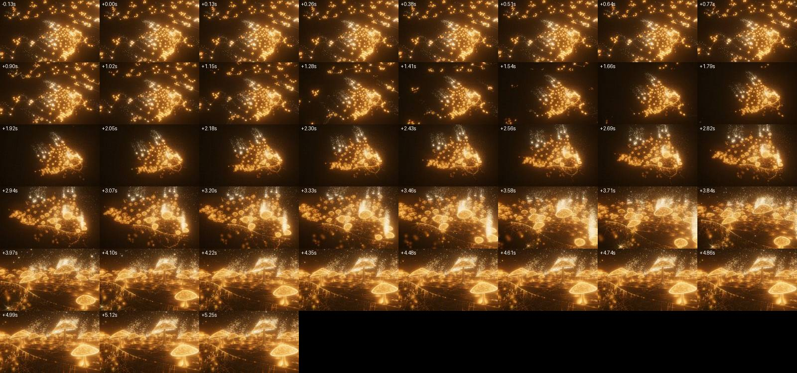
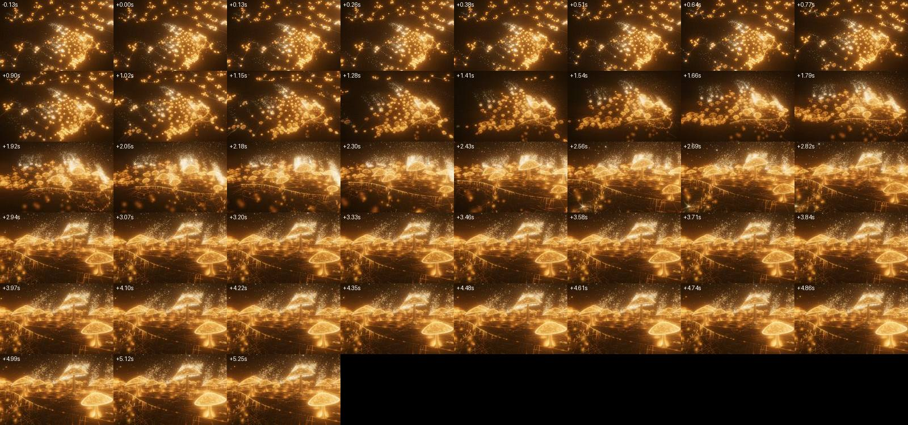
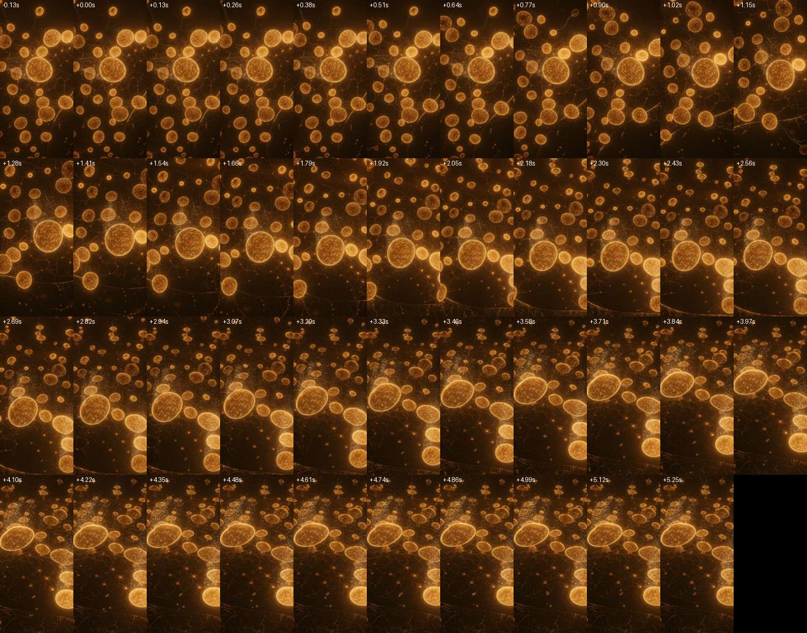
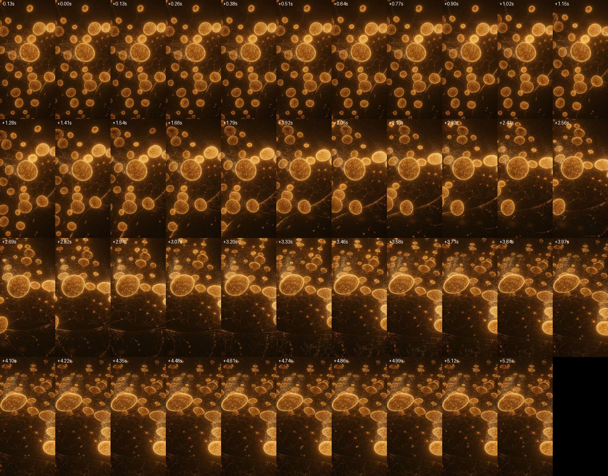

# Manifesto → Purpose return, v3: one glide

Branch `fix/manifesto-return-v3`. Owner, on the live site after two rounds of fixes: *"The transition from the manifesto to purpose is still very janky. Revisit from first principles to make it smooth like the others."*

**In one line:** the Return no longer replays the climb backwards. Every way down (Return, a rail tap to another section, a second press, Return pressed mid-climb) is now one glide on one clock with one quintic ease, the same kind of move as every other hop on the site. It is described by what the viewer sees: heading, tilt, bank, where the hero sits on screen, how big it looks, and the lens. Phone and desktop run the same law.

**Headline numbers** (all from the browser; ratios are against the ordinary Connect → Purpose hop on the same device):

| Return from the top of the Manifesto | before | after | Connect → Purpose |
|---|---|---|---|
| **Phone 390×844**: peak screen flow (px/frame @640) | 15.5 (1.54×) | **5.2 (0.52×)** | 10.1 |
| Phone: worst single-frame change in flow (px/frame²) | **7.03 (40×)** | **0.065 (0.38×)** | 0.173 |
| Phone: peak turn rate | 132 °/s (1.6×) | **41 °/s (0.51×)** | 82 °/s |
| Phone: surges of motion (flow / speed / turn) | 2 / 2 / 1 | **1 / 1 / 1** | 2 / 1 / 2 |
| **Desktop 800×500**: peak screen flow | 3.3 (0.47×) | **5.2 (0.74×)** | 7.05 |
| Desktop: worst change in flow | 0.121 (1.09×) | **0.102 (0.92×)** | 0.111 |
| Desktop: surges (flow / speed / turn) | 1 / 1 / **2** | **1 / 1 / 1** | 1 / 1 / 1 |
| Desktop: hero screen-y reversals | **2** | **0** | 3 |
| Duration (phone / desktop) | 4.78 / 4.77 s | 4.51 / 3.42 s | 5.1 / 5.0 s |

- **Phone** (the path the brief says was left unfixed last round). The jank is gone:
  - Before, the picture spun in place for 1.3 s at up to 132 °/s, as the 85° overhead turn unwound. Then, within two frames, it changed gear to a tilt: flow 15.5 → 5.9 px/frame, turn 132 → 37 °/s. It then dipped, surged again and crept in.
  - After, it is one gesture: the view turns gently while it tilts up out of overhead, the hero stays near centre, and it settles.
- **Desktop.** Round 2 had already removed the sideways slide. What remained:
  - two separate turning surges;
  - the hero bobbing up and down on screen twice;
  - a shape where the camera barely descended for 1.6 s while the colony shrank in frame, then plunged in the last ~2.4 s.

  After, the camera sinks once, the cluster grows in place and the ground rises to meet it. The move is 1.35 s shorter.
- **Interruptions now behave like everything else:**
  - A Return pressed early in the climb used to stop dead in one frame (flow 1.24 → 0 desktop, 1.66 → 0 phone). It now carries the climb's motion across the press (1.24 → 1.23, 1.66 → 1.66) and turns it around smoothly.
  - Under a clock with 90–200 ms dropped frames, the Return's path stays smooth in wall time: largest kink 0.11 px (desktop) and 0.17 px (phone). The old law gave 0.28 / 1.27 px, and the ordinary hop, which slows down under drops, gives 0.87 / 0.74 px.
- **Frame work is not where the jank was:**
  - The new law costs 0.32 ms once per press and under 1 µs per frame.
  - Click and landing frames stay within ~1.6× the median descent frame in JS, mutations, layouts and GL uploads.
  - One residual: the click frame's **style recalc** (~13 ms vs ~1.5 ms median in this container), which is unchanged from before. See §3.4 and §6.

## 1. What "janky" turned out to be

Everything below was measured in headless Chromium (SwiftShader) on this branch's parent (`9c5736c`, "before") and on this branch ("after"). The fake clock was paused and stepped 16 ms per frame (62.5 Hz). Screen numbers are pixels per frame at 640 px wide. That is the brief's frame: the phone's 390 px are scaled by 1.64 and the desktop's 800 px by 0.8. "Flow" is the mean on-screen motion of a fixed 9×7 grid of screen points cast onto the ground, i.e. how fast the whole picture moves.

Ranked by size:

1. **Phone motion: a spin, then a gear change, then a creep.** This is the largest by an order of magnitude. *BROWSER, phone, Return from the top, before:*
   - **0–1.3 s.** The camera stays straight overhead while the climb's 85° turn unwinds. The picture *rotates in place*, flow climbing to 15.5 px/frame and the turn rate to 132 °/s. That is 1.5× and 1.6× the ordinary hop's peaks.
   - **1.3 s.** In two frames the motion changes character: flow 15.5 → 5.9 px/frame, turn 132 → 37 °/s. The worst single-frame change in flow is **7.03 px/frame²**, against **0.17** for the ordinary hop (40×). This is the "jolt", and it falls *mid*-flight.
   - **1.3–4.8 s.** A tilt surge, a dip to 1.5 px/frame, a second surge at ~2.1 px/frame, and a long creep: two lobes of motion.
   - Starts at 0.5 and 0.8 measured the same shape: 3 flow lobes, peak 13–15.5 px/frame, worst flow change 5.6–7.3. The cause is structural: the descent is two laws in sequence (unwind the turn, then the tilt), keyed through `descentU` to a climb whose turn and tilt run on different clocks.
2. **Desktop motion: two turning surges, the hero bobbing, and a late plunge.** *BROWSER, desktop, from the top, before:*
   - flow is single-lobed (peak 3.3 px/frame), but the **turn rate has two lobes**;
   - the hero's screen **y reverses twice**;
   - the height is keyed half to the climb's clock: in the first 1.6 s the camera loses under 10 % of its height (`y` 70 → 63.5) while the outer field retires and the colony shrinks in frame, then it drops ~60 units in ~2.4 s (`y` 63.5 → 4.4 between 1.6 s and 4.0 s). The contact sheet shows it plainly.

   The round-2 corrections (shift release, orbit on `k`, screen-x pin) fixed the sideways slide they targeted. They did not change this shape.
3. **Interruptions: the press itself is a velocity step.**
   - A Return pressed in the first seconds of the climb stopped the camera dead in one frame: flow 1.24 → 0 px/frame on desktop and 1.66 → 0 on the phone, then restarted the other way.
   - A rail tap to another section from the top was a separate flight law (`createReturnFlight` with an aim rotation), with 2 hero-x and 2 heading reversals on desktop.
   - A second press of the same destination is absorbed by `leaveManifesto` (identical to the single press, before and after).
4. **Dropped frames.** The branch already stepped on wall time. Under a fake clock with 150/90/200 ms hitches, the old law's path was smooth in time on desktop (largest kink 0.28 px). On the phone it was not (1.27 px), because the spin-to-tilt switch lands on whichever frame crosses it. For comparison, the ordinary hop *slows down* under the same drops (its `dt` is clamped at 50 ms), so its path in wall time kinks by 0.74–0.87 px.
5. **Frame work: small, and not the cause.** *BROWSER, before, top:* click frame JS 23–44 ms against a 15–16 ms median, the landing frame 15–24 ms, with mutations, layouts and GL uploads flat (67 KB/frame throughout).
   - The only clear spike is the click frame's **style recalc**: 13.1 ms against ~1.5 ms (CDP `RecalcStyleDuration`), from adding `.is-returning`. Removing the panel's inherited `pointer-events: none` cut it to 8.3 ms in one A/B sample.
   - The landing frame is calm: one layout, a manifesto-root class change, `display: none` on the hidden root.
   - The phone's 8-second rest cadence never engaged during or within 30 frames of a landing (0 skipped renders). It engages 8 s after landing, as designed.
6. **Not found:**
   - no camera jump at the hand-off: exit applies the authored rest, the final flow steps were 0.02 → 0.01 → 0.004 → 0, and later frames move by under 0.001 px;
   - no landing flash: the largest cell step within ±6 frames of landing is 1.41/255 before and 1.45/255 after, inside the scene's own frame-to-frame noise of 0.4–1.8/255, and `test-final-ring-handoff` passes;
   - no CSS animation still running at landing.

## 2. The design

### What it is

`journey/manifesto/glide.js` (new, ~200 lines). A glide is a start (the frame on screen at the press, with its per-frame velocity) and a landing (the destination's authored rest). Between them it eases **seven channels a viewer actually sees**, all on one quintic smootherstep phase `e = smoother(t / seconds)`:

| channel | what it is |
|---|---|
| `yaw`, `pitch`, `roll` | the view's heading, tilt and bank. These are scalars, so straight down is not a singularity: turning there is just the picture rotating about its centre. Heading takes the short way. |
| `sx`, `sy` | where the **anchor** (the hero's cap, `(0, 2, 0)`) sits on screen, in normalised device coordinates. Eased linearly, so the hero moves along a straight screen line. |
| `scale` | `log(depth × tan(fov/2))`: the hero's apparent size. It is monotone by construction, so the move has no dolly-zoom breathing. |
| `fov` | the lens, on the same phase |
| `look` | log of the look-target distance, for code that reads `controls.target`. It does not affect the picture. |

The camera's world position is **not interpolated**. It is solved exactly from those channels (`glidePose`): the anchor lands at exactly `(sx, sy)` at the depth its scale names. Any camera pose can be written as these channels, and any channels give exactly one camera, including straight overhead.

- **Continuity at the click.** Each channel's presented velocity (from the last two frames the branch drew) enters through the quintic's tangent term `v·T·(k − 6k³ + 8k⁴ − 3k⁵)`. That term is zero at both ends, with zero slope and zero curvature at the landing. A press mid-climb therefore continues the climb's motion for a moment and turns around smoothly. It does not reverse in one frame.
- **One ease, exact landing.** At `k = 1` the channels equal the rest's own channels. The branch then hands over the authored rest pose byte for byte (`exit()`), as before. Purpose's rest frames are untouched.
- **Duration** is priced by how far the **picture** travels, not the camera. That is the screen-flow distance summed along the glide, in half-widths of the frame, and never less than the hero's own screen line. It also accounts for how far the view turns:
  - `seconds = clamp(2.6, max(1.8 s × travel, 1.875 × turn / 60°/s), 6)`
  - A quintic peaks at 1.875× its mean, so the second term holds peak turn rate near 60°/s. 2.6 s is the floor every other hop has (`navigation-timing.js`).
  - The 1.8 constant was set against the measured Connect → Purpose hop (§3). From the top that gives 3.45 s on desktop and 4.5 s on a phone. A Return pressed early is 2.6 s.
- **Everything else rides the same phase**, from the value on screen when the glide began:
  - the colony's clock `u = u₀(1 − e)`;
  - the ring copies' light `seat₀(1 − smoother(e/0.7))`;
  - the extra field's presence `1 − smoother((e − 0.05)/0.45)`;
  - Purpose's world (`stay`), the fog range and the aerial atmosphere.
- **The text and scrim** are timed to the glide:
  - The reading shade fades over exactly `glide.seconds` (`--manifesto-return-s`).
  - The words leave in 1 s, as ordinary copy does.
  - The page's own copy (`j-manifesto-closing`) is released `CHROME_FADE_MS` (1.6 s) before landing instead of at 72 % of the descent, so its fade ends on the landing frame.
- **The rail and logo** read `returnPhase`, which is now the glide's `e`. It is published on the passage ticket exactly as a blend publishes `railMotion.phase`.
- **Interruption has no special cases.** A Return pressed mid-climb, a second press, a rail tap to another section mid-descent, or a Return during the entry flight from another section each starts a fresh glide from the frame on screen, with its velocity. Retargets keep a 2.6 s floor.

### Why not the alternatives

- **Route it through `directJumpTo` / `camera-blend.js`.** That would be the ideal, and I tried to see if it fits. Three things stop it:
  1. During a plain Return the journey is *already* on Purpose: `directJumpTo` returns at `Math.abs(targetP − journey.progress) < 1e-4`.
  2. The blend lerps the look target and orients with the world-up roll (`applyCameraRoll`). From the phone's straight-down top view, world-up has no heading, which is the singularity behind last round's phone swing.
  3. The blend's destination is the director's live pose, and its scene drives are chapter entries. The Manifesto's colony/field lease is owned by the branch.

  So the glide is the *same kind of move* (one captured start, one rest, one clock, one quintic, phase published on the ticket), built where the Manifesto's state lives. It does not re-use the blend's code.
- **A straight world chord with quaternion slerp.** Rejected:
  - From 70 units up, a chord to Purpose's rest passes over the colony at a grazing angle, and the hero sweeps off-line on screen.
  - Slerp between two level views tilts the horizon mid-move on desktop, a bank nobody asked for.
- **Orbit coordinates about the hero (azimuth, elevation, distance).** Rejected: azimuth is undefined at elevation 90°, which is exactly where the phone's climb ends.
- **Keep the replay and patch it again.** Rejected after measuring (§1). The phone's problem is not a constant to tune. It is two laws in sequence: the 85° overhead turn unwinding, then the tilt. That is a gear change by construction.
- **A deliberate crossfade through a held frame.** Not needed. A physically continuous path measured within the targets.
- **Shorter is better?** The duration is a law, not a choice per case. A Return pressed early is already at the 2.6 s floor. From the top, the measured peak screen speed sits *below* the reference hop's (§3), so the return is no faster or more abrupt than a rail tap.

## 3. Before / after against the targets

**Method.**
- Headless Chromium on SwiftShader. `page.clock` is paused and stepped 16 ms per frame.
- QA hooks are injected with `page.route`; the repo is untouched. They expose the branch state, a seek of the climb clock, and a post-render callback.
- Per frame the capture records:
  - the camera (position, quaternion, fov);
  - JS time inside rAF excluding GL calls, measured with the real clock;
  - DOM mutations, CDP `LayoutCount`/`RecalcStyleCount` and their durations;
  - GL upload bytes, draws and program switches;
  - running CSS animations, the body classes, and a 4×4 luma grid.
- Screen metrics are computed from each frame's camera. Flow is the mean motion of a fixed 9×7 screen grid cast onto the ground; the hero is the cap `(0, 2, 0)`.
- **Render modes.** Desktop at the top of the Manifesto renders at ~8 s/frame here. So the two **top** captures (before and after, phone and desktop) were fully rendered, at half device scale on desktop. All other starts and interrupted cases ran in the same browser with only the composer skipped (`render disabled`): all page JS, DOM, CSS and timers run.
- "BROWSER" below means one of these runs. "SIM" means the node meter (`tools/test-manifesto-return.mjs`, real THREE camera).
- Scripts: the session scratchpad (`capture.cjs`, `analyze.mjs`, `metrics.mjs`). They are not committed.

**Reading the columns:**
- *peak flow* is px/frame at 640 wide;
- *flow acc* is the largest single-frame change in flow;
- *surges* is the number of lobes of flow / camera speed / turn rate;
- *rev* is reversals of hero x / hero y / heading / hero apparent size. For presses mid-climb they are counted after the glide's turnaround (the first third), because continuity requires exactly one smooth turnaround there;
- *click* is the flow on the frame before → the frame of the press.

### 3.1 Desktop 800×500 (ref Connect → Purpose: 5.01 s, flow 7.05, acc 0.111, turn 95.8 °/s, surges 1/1/1, rev 0/2/0/2)

| case | src | before: s · peak flow · flow acc · turn °/s · surges · rev · click | after: s · peak flow (×ref) · flow acc (×ref) · turn · surges · rev · click |
|---|---|---|---|
| from top (u=1) | BROWSER rendered | 4.77 · 3.28 · 0.121 · 42 · 1/1/**2** · 0/**2**/0/0 · 0→0 | **3.42 · 5.24 (0.74×) · 0.102 (0.92×) · 56 · 1/1/1 · 0/0/0/0** · 0→0 |
| u = 0.8 | BROWSER | 4.26 · 3.57 · 0.139 · 45 · 1/1/1 · 0/**2**/0/0 · 0.17→**0** | 3.28 · 5.32 (0.75×) · 0.109 (0.98×) · 56 · 1/1/1 · 0/0/0/0 · 0.17→0.17 |
| u = 0.5 (mid-sentence) | BROWSER | 3.47 · 3.74 · 0.169 · 50 · 1/1/**2** · 0/**2**/0/0 · 0.41→**0** | 2.58 · 4.58 (0.65×) · 0.119 (1.07×) · 49 · 1/1/1 · 0/0/0/0 · 0.41→0.41 |
| u = 0.25 | BROWSER | 2.82 · 3.64 · 0.202 · 59 · 1/1/1 · 0/**2**/0/0 · 0.34→**0** | 2.58 · 3.25 (0.46×) · 0.085 (0.77×) · 45 · 1/1/1 · 0/0/0/0 · 0.34→0.34 |
| Return at 1.5 s into the climb | BROWSER | 2.22 · 1.34 · 0.049 · 15 · 1/1/1 · 0/0/1/0 · 1.24→**0** | 2.58 · 1.60 · 0.045 · 21 · 1/1/1 · 0/0/0/0 · 1.24→1.23 |
| rail tap to Connect from the top | BROWSER | 7.44 · 3.21 · 0.036 · 40 · 1/1/1 · **2**/0/**2**/0 | 4.91 · 4.74 · 0.056 · 60 · 1/1/1 · 0/0/0/0 |
| Return, then Connect 1.4 s later | BROWSER | — | 6.70 · 5.88 · 0.058 · 53 · 1/1/1 · 0/0/0/1 (the size turns once: a new destination) |
| Return pressed twice (60 frames apart) | BROWSER | = single press | = single press (the journey absorbs the repeat; the branch-level repeat is pinned in node, §3.5) |
| Return 3 frames after a resize to 800×460 | BROWSER | — | 3.09 · 5.31 · 0.114 · 60 · 1/1/1 · 0/0/0/0 · 0.16 at the press |
| irregular clock (16/150/90/200 ms) | BROWSER | wall-time kink 0.283 px | **0.114 px** (ref under the same clock: 0.867) |

### 3.2 Phone 390×844 (ref Connect → Purpose: 5.10 s, flow 10.06, acc 0.173, turn 81.6 °/s, surges 2/1/2, rev 4/1/0/1)

| case | src | before | after |
|---|---|---|---|
| from top | BROWSER rendered | 4.78 · **15.54 (1.54×)** · **7.029 (40.6×)** · **132** · **2/2**/1 · **2/1**/0/**2** · 0→0 | **4.51 · 5.22 (0.52×) · 0.065 (0.38×) · 41 · 1/1/1 · 0/0/0/0** · 0→0 |
| u = 0.8 | BROWSER | 4.27 · 15.47 · 7.345 · 131 · **3**/2/1 · 1/1/0/1 · 0.32→**0** | 3.95 · 5.39 (0.54×) · 0.077 (0.45×) · 43 · 1/1/1 · 0/0/0/0 · 0.32→0.32 |
| u = 0.5 | BROWSER | 3.49 · 12.95 · 5.618 · 110 · **3**/2/1 · 1/1/0/1 · 0.32→**0** | 2.82 · 5.41 (0.54×) · 0.110 (0.64×) · 45 · 1/1/1 · 0/0/0/0 · 0.32→0.32 |
| u = 0.25 | BROWSER | 2.83 · 7.59 · 2.208 · 57 · **3**/2/1 · 1/1/0/**2** · 0.32→**0** | 2.58 · 4.38 (0.44×) · 0.099 (0.57×) · 38 · 1/1/1 · 0/0/0/0 · 0.32→0.32 |
| Return at 1.5 s into the climb | BROWSER | 2.30 · 2.09 · 0.087 · 9 · 1/1/1 · 1/0/0/0 · 1.66→**0** | 2.58 · 2.45 · 0.060 · 15 · 1/1/1 · 0/0/0/0 · 1.66→1.66 |
| rail tap to Connect from the top | BROWSER | 7.42 · 4.12 · 0.029 · 35 · 1/1/1 · 1/1/1/0 | 5.50 · 5.29 · 0.048 · 45 · 1/1/1 · 0/0/0/0 |
| Return, then Connect 1.4 s later | BROWSER | — | 7.41 · 7.76 · 0.081 · 59 · 1/1/1 · 0/0/1/1 (one turn toward the new destination) |
| Return pressed twice | BROWSER | = single press | = single press |
| Return 3 frames after the toolbar resize 844 → 760 | BROWSER | — | 3.62 · 5.38 · 0.084 · 47 · 1/1/1 · 0/0/0/0 |
| irregular clock | BROWSER | wall-time kink **1.269 px** | **0.173 px** (ref: 0.736) |

The other reference hop, Purpose → Connect, is livelier than either: desktop 3.26 s, flow 10.9, acc 0.221, 133 °/s; phone 3.34 s, flow 15.7, acc 0.34, 122 °/s (BROWSER). Against it, every after-number above is below 0.75×.

### 3.3 The other targets

| target | result |
|---|---|
| one acceleration lobe (camera speed, turn, screen flow) | after: 1/1/1 in every one-destination case on both devices (BROWSER). For presses mid-climb, counted after the turnaround. SIM: `test-manifesto-return.mjs` pins it for 5 viewports × 5 starts. |
| zero reversals: hero x and y, heading, apparent size | after: 0/0/0/0 in every one-destination case (BROWSER); pinned in SIM. A mid-descent change of destination turns once toward the new place, by design. |
| no frame jumps off the path (≤1.5 px), including click, hand-off and landing | worst deviation of a frame's hero step from its neighbours' mean: before 0.906 px (phone top) / 0.016 (desktop top); after **0.000–0.005 px** in every case (BROWSER). Peak hero *speed* after: desktop 0.8 px/frame, phone 1.2 px/frame from the top. A Return early in the phone's climb carries the climb's own 3.1 px/frame and peaks at 4.1. |
| click-frame velocity continuous with the climb | after: flow on the press frame equals the frame before in every mid-climb case (BROWSER, the "click" column). Before: dropped to 0 in every case. Pinned in node at the branch level, and the pin fails on the old law (1.5 s press: change 100 % of speed). |
| peak screen speed and acceleration ≤ 1.3× the reference hop | after: speed 0.44–0.75×, acceleration 0.38–1.07× on both devices (BROWSER). |
| landing: zero rate, exact rest | last flows into landing: desktop 0.026 → 0.012 → 0.003 → 0, phone 0.014 → 0.007 → 0.002 → 0 (the ref hop: 0.016 → 0.008 → 0.002 → 0). The pose is the authored rest (`exit()`); Purpose's rest frames are bit-identical. |
| nothing changing > 250 ms after landing | no CSS animation runs from the landing frame on. The last DOM change is `j-manifesto-closing` removed at +112 ms (it used to be released at 72 % of the descent; it is now released so its 1.6 s fade ends on landing). Camera after landing: < 0.001 px/frame, the scene's own idle motion, as after any hop. **Caveat:** the canvas's mean luma keeps drifting for ~2–3 s after *any* landing on Purpose (Return before −7.7/255, after +4.7 then −5; Connect → Purpose +20). That is Purpose's own post-arrival settle. It is not introduced here, and I did not trace it (§6). |
| back-field luminance monotone through landing | largest cell step within ±6 frames of landing: before 1.41 / after 1.45 (desktop), 2.06 / 1.58 (phone), inside the scene's frame-to-frame noise (0.4–1.8). `test-final-ring-handoff` (round 2's flash fix) passes. |
| irregular clock: no jump larger than the dropped time's share | the glide is a pure function of wall time, so a 200 ms frame advances exactly 200 ms of path: kink 0.11–0.17 px (BROWSER). |

### 3.4 Frame work at the click and the landing (BROWSER, rendered, from the top)

Each cell is median descent frame / click frame / landing frame. JS is ms inside rAF excluding GL; it is noisy on this 4-core software-GL host, where other runs spike to 200–600 ms on frames where the branch is not even running.

| | JS ms | DOM mutations | layouts | style recalcs (count; click ms) | GL upload bytes |
|---|---|---|---|---|---|
| desktop before | 15.8 / 43.8 / 23.7 | 27 / 31 / 23 | 1 / 2 / 1 | 3 / 5 / 2; **13.1 ms** | 67 200 / 67 200 / 67 200 |
| desktop after | 17.9 / 28.2 / 16.4 | 37 / 32 / 23 | 1 / 2 / 1 | 3 / 8 / 4; **13.9 ms** | 67 200 / 67 200 / 67 200 |
| phone before | 14.7 / 23.5 / 14.9 | 27 / 31 / 25 | 1 / 2 / 2 | 5 / 10 / 4 | 67 200 / 67 200 / 85 120 |
| phone after | 16.5 / 25.4 / 17.6 | 27 / 31 / 25 | 1 / 2 / 2 | 5 / 9 / 5 | 67 200 / 67 200 / 85 120 |

- The new law's own cost is 0.32 ms once per press (`createGlide`, including pricing its duration) and 0.75 µs per frame (`sampleGlide`). These are node microbenchmarks.
- The **click-frame style recalc is the one item over 2×**, and it is unchanged by this work. Adding `.is-returning` restyles the reading panel and, through the inherited `pointer-events: none`, every word span. It also flips `body:has(.j-manifesto.is-returning)`.
- A/B in the browser (render disabled, u = 0.5): removing that `pointer-events` line took the recalc from 12.4 to 8.3 ms. That is one sample, in a container where a MacBook would be several times faster. I have **not** changed it (§6).

### 3.5 Tests

- **`tools/test-manifesto-return.mjs`** is rewritten for the new contract. Through a real THREE camera at 62.5 Hz, from 5 viewports (1440×900, 1280×720, 800×500, 390×844, 430×932) × 5 starts, it checks:
  - the move is bounded (2.6–6 s);
  - no step in flow or hero pace at the press;
  - one surge of flow and of camera speed, and at most one of turn;
  - zero reversals of hero x, hero y, apparent size and heading after the turnaround, and from the very first frame from the top;
  - no frame jumps off the path (≤0.25 px @640);
  - zero rate and the exact rest position and orientation at landing.

  It also pins:
  - that a **replayed climb fails the meter** on both phones;
  - that the glide has no device fork and the branch has no replayed descent or second return law;
  - pole safety (glides from exactly overhead, five headings, turn rate continuous);
  - exact channel round-trip.
- **`tools/test-manifesto-motion.mjs`**:
  - New branch-level oracles: a Return pressed at 1.5 / 9 / 20 s continues the climb's motion across the press (change <2 % of speed), and a second press 1 s later continues the glide on screen and still lands exactly. **Run against the old branch, the first fails** (change = 100 % of speed).
  - Updated pins: the phone descent is now checked as a glide (monotone height, last tenth a settle); the away-landing timing is now "priced by the same law, longer for Ownership, bounded"; the Escape-return timing reads the glide's own duration.
- **`tools/test-mobile-manifesto-range.mjs`**: the descent-monotone pin now runs the glide.
- **`tools/test-manifesto-entry.mjs`**: "Return during the entry" and "into the ground" now run the glide.

Node suites, before (`9c5736c`) → after:
- **pass on both:** test-manifesto-motion, -return, test-mobile-manifesto-range, test-manifesto-entry, -concepts, test-colony-retirement, test-final-background-tissue, -ring-handoff, -spore-ownership, test-frame-order, test-transition, test-no-scroll-navigation, test-mobile-stability, test-rest-warm-queue, test-return-pace;
- **fail on both, with the identical first error:** test-rail-handoff, test-chapter-contract, test-frame-publication, test-global-hooks, test-page-lifetime. These are environment and shallow-clone failures that predate this branch.

**After merging `origin/main` (`f125fb2`, visible-viewport work):**
- `runtime/266e397a…` is built and verified. The earlier `84bebd5c…` is kept.
- The same node suites pass and fail as before the merge.
- A sanity phone Return from the top (BROWSER, render disabled) on the merged source and on the merged release build reproduces the numbers above exactly: 4.51 s, flow 5.22, flow change 0.065, one surge, 0 reversals, 41 °/s, no page errors.
- The glide reads no window size: it takes the camera's own aspect. That aspect is set by the renderer, which now reads `visible-viewport.js`.

Before the merge, `npm run runtime:check` verified `runtime/84bebd5c…`. The release build (`RUNTIME_MODE=release`) booted on 800×500 and 390×844 with **no page errors**. A Return from the top (desktop 3.45 s, phone 4.54 s), a rail tap to Connect (desktop) and an early Return (phone) all completed. These release runs had the composer disabled.

## 4. Contact sheets

Every 8th frame (0.128 s), from the press to landing plus ~1 s, Return from the top. They are rendered in the browser (desktop at half device scale) and read left to right, top to bottom.

- `img/return-v3-top-before-desktop.jpg`. The wide field shrinks to a compact cluster and darkens while the camera barely descends (under 10 % of its height in 1.6 s). From ~2.8 s it plunges and swings: the ground and the hero arrive in the last ~2 s.
- `img/return-v3-top-after-desktop.jpg`. **One continuous sink.** The cluster grows in place from the first second and the ground rises to meet it. Around 1.9–2.4 s the camera passes low over the field outside the ring, much as the Connect → Purpose flyby does, and the epilogue's spore plumes are large and bright at top right. I checked full-size frames: nothing clips the lens. It is settled by ~3.3 s. To my eye it reads as one calm glide home. If anything bothers the owner here, I would expect it to be that bright low pass.
- `img/return-v3-top-before-phone.jpg`. 0–1.3 s, the picture rotates in place around the hero. Then it abruptly tilts; the composition is nearly final by ~3.5 s and creeps to 4.8 s.
- `img/return-v3-top-after-phone.jpg`. **One gesture.** The hero stays near the centre-left while the view turns gently and tilts up out of overhead. The horizon arrives between ~1.5 and 2.5 s, and it settles at ~4.0–4.5 s. There is no spin burst and no change of gear.

## 5. What was deleted

- `journey/manifesto/pose.js`:
  - `descentU`, `descentPose`, `descentSpiral`, `descentFrameShift`, `anchorScreenX`, `DESCENT_ANCHOR` and `climbProfile` (the replay and its three round-2 corrections);
  - `descentFieldPresence`, `returnSecondsFrom`, `awaySecondsFrom`, `RETURN_SECONDS`, `RETURN_MIN_SECONDS`, `AWAY_SCALE`, `AWAY_EXTRA_SECONDS` (the start-dependent duration laws);
  - the `{ shift, spiral }` override parameters of `manifestoPose` / `frameShiftAt`.

  **The climb is bit-identical.** I compared the JSON of 2,796 poses (both rests, three aspects, 0–34 s) against `9c5736c`, and the warm-plan bit-identity tests pass.
- `journey/manifesto/branch.js`:
  - the landing blend (`landW`, `landPrev`, `landRe`, `retargetW`) and the rate clock (`returnK`, `returnRate`);
  - `seatAtReturn`, `departAtReturn`, `CHROME_RELEASE`;
  - all use of `createReturnFlight` for the way down;
  - the `awaySeconds` getter. It is replaced by `secondsTo(land)`, which prices the actual glide.
- `journey/manifesto/return-flight.js`: the `rootApproach` Bézier for underground landings. The glide approaches Ownership from its own framing; the oracle checks orientation continuity and exact landing. The file now serves only the entry flight.

## 6. What I could not verify here, and what to look at

**Not verified here:**
- **Real hardware at 60/120 Hz, and iOS Safari.** Every number is SwiftShader under a fake 62.5 Hz clock. The law is time-based (wall seconds), so at 120 Hz each frame takes half the step. The quintic is C² at both ends, so a ProMotion display should only look smoother; I have not seen it.
- **Frame cost in milliseconds.** Under software GL I counted work, not GPU time. The JS numbers are noisy on this host.
- **The click-frame style recalc** (§3.4). It is unchanged and is the one frame-work item over 2×. A likely cheap fix:
  1. drop `pointer-events: none` from `.j-manifesto.is-returning .j-manifesto-panel` (the links are already `aria-disabled` and their handler refuses clicks while returning);
  2. replace `body.j-manifesto-open:not(:has(.j-manifesto.is-returning))` with a body class set in `returnTo`.

  I measured only one sample of (1), and (2) not at all, so I left both out rather than ship an unverified CSS change on the owner's text.
- **Purpose's own post-landing settle.** Canvas luma keeps drifting for 2–3 s after any landing on Purpose (Connect → Purpose: +20/255), and after the Return (before −7.7, after +4.7 then −5). I did not trace which of Purpose's eased states it is. It is not new, and it is not a step.
- **The desktop low pass.** At ~2 s the desktop glide passes low over the field outside the ring (y ≈ 8–12 at radius ~25). I checked frames for clipping, not a body-by-body clearance.
- **Render-disabled runs.** All non-top starts and interrupted cases ran with the composer skipped. Camera, DOM and timing ran exactly; luma and GL were not measured there.
- **Pre-existing, not touched:** a window resize mid-climb re-poses the desktop climb itself (its height depends on aspect). The Return 3 frames later is continuous from whatever is on screen.

**What the owner should look at:**
- **On the iPhone** (the biggest change):
  - Open the Manifesto, let it reach the top, and press Return. It should be one movement: the view turns gently while it tilts up from looking straight down, the main mushroom stays near the middle, and it settles in about 4½ s. No spin first, and no moment where the motion changes gear.
  - Then press Return about two seconds into the climb. The camera should keep its upward drift for a beat and turn around smoothly, not stop dead.
  - Try a rail tap to another section from the top.
- **On the MacBook:**
  - Return from the top: one continuous sink in about 3½ s. The colony grows in place, the ground comes up to meet it, and it lands with no second move.
  - Also try Return halfway through a sentence, and Escape twice quickly.
  - At touchdown, the back mushrooms should not brighten (round 2's fix still holds).
  - The one moment I would ask about is the low, bright pass over the spore plumes around two seconds in.

