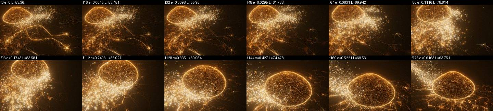
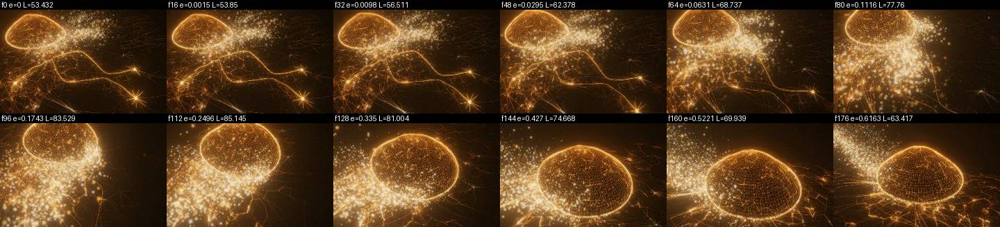
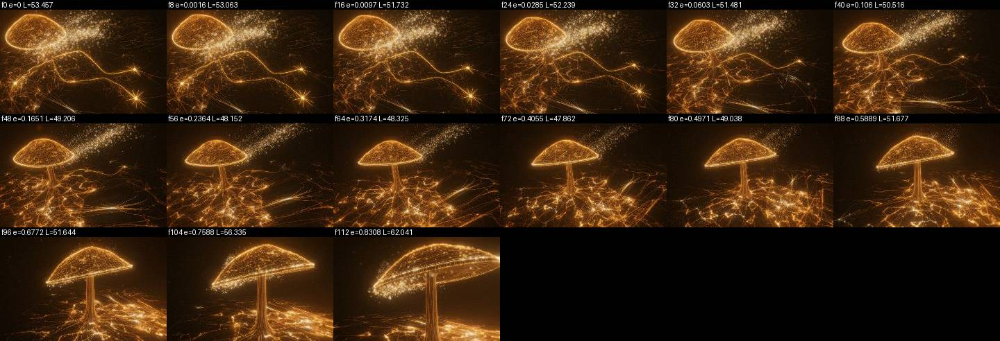
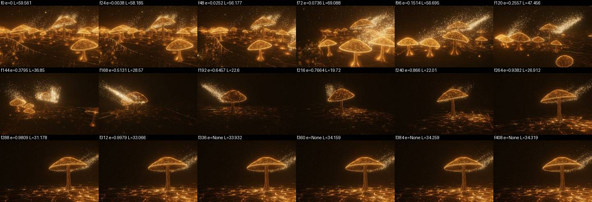
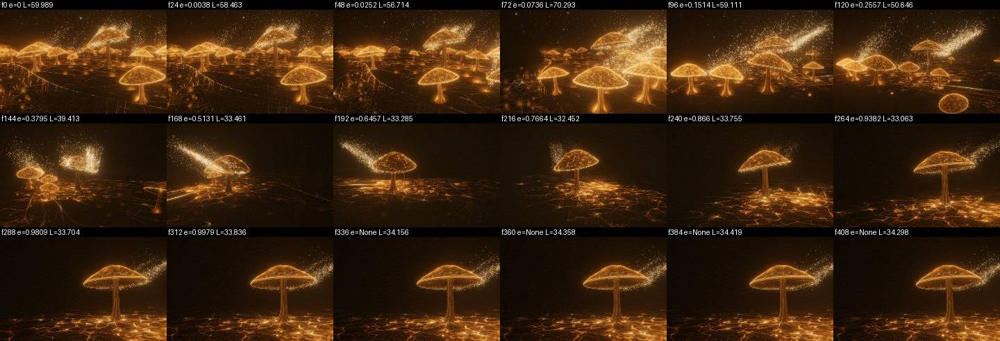
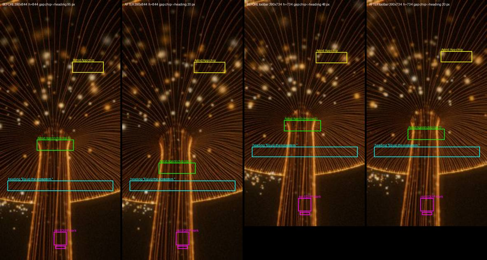

# Transitions, round 2: report

Branch `fix/transitions-round2`. One commit per item, plus a runtime release.
**Summary.**
1. Connect's ground lines now dissolve on the departing flight's own phase:
   Connect -> Purpose 90->10% went from 0.70 s to 1.38 s, and Connect -> Equip from a
   two-frame cut to 0.91 s. Rests are bit-identical.
2. Purpose -> Intro no longer dims and comes back: the mid-lap luma valley went
   from -43% to -5% and the rebound from 15 to 2. The web bloom is now a crossfade,
   plus a lens exposure bridge mid-lap. That bridge is a judgement call; see the
   item.
3. The element is the "Astrid Agent" marker. Its position relative to the "Equip"
   heading depended on visible height (the iOS toolbar). On phones it now rests
   20 px above the heading at every height, and it no longer lingers below
   the heading after a toolbar resize.

Commits: `ebcb202` (item 1), `5887c92` (item 2), `df3f8e5` (item 3), and a runtime
release `efaa28ef` (`npm run runtime:check` passes, `npm run test:runtime` passes).

How everything was measured: headless Chromium + SwiftShader under Playwright's
fake clock (`page.clock.install(); pauseAt(...)`, then `runFor(16)` per frame),
per-frame state logged from inside `composer.render`, frame luma read with
`gl.readPixels` straight after the render. Desktop captures are 640x400; phones
are 390x844 / 375x667 / 430x932 with `isMobile` + `hasTouch`. "Before" always
means current main, served from a separate worktree on its own port, so before
and after were measured with the same harness on the same machine. The
measurement scripts are not committed (they are scratch tools, the same kind
as the `polish/tools` branch).

---

## Item 1: Connect's ground lines vanish too fast when leaving

### Measured before

Two different mechanisms, depending on the destination:

| hop (640x400) | what drove the fade | uAmount 90% -> 10% | where in the flight |
|---|---|---|---|
| Connect -> Purpose (5.0 s flight) | seam disarms on the click tick; `amount` falls on its 3/s first-order lag | **0.70 s** (f2 -> f46) | done at **15%** of the flight, camera eased phase e = 0.026 (it had barely moved) |
| Connect -> Equip (2.6 s) | the seam stays armed (the Equip rest sits inside Connect's seam window); the network is cut by the camera-gaze `resolve` gate as the camera pitches up | **0.05 s** (0.93 -> 0.07 in two frames, f101 -> f104) | at **62%** of the flight, +1.6/255 frame-luma step at the hide |

Connect -> Intro takes the Connect -> Purpose path (disarm + lag).

Root cause: `journey/chapters/connect/index.js`. The animator's
`amount += (amountTarget - amount) * min(1, dt*3)` (about line 1135) runs on
its own clock from the click, and the drawn value
`amount * resolve * entryReveal` (about line 1158) has a second, camera-shaped
cut in `resolve`. Neither is tied to the flight. This is the "many clocks"
pattern from O3 again.

### Fix

On a governed nav move whose destination is not Connect, `setBlending(true, ..., durS, dstId)`
latches the amount that was last drawn (`U.uAmount` of the frame before the
click). From then until the blend ends, the drawn amount is a pure function of
the flight phase. It takes the camera's published smootherstep `e`
(`frame.transitionPhase`), inverts it to a time-linear fraction (the same
inversion `final/index.js relightOf` uses), and applies a C1 smoothstep that
reaches zero at `DISSOLVE_SHARE` = 45% of the flight, never sooner than
`DISSOLVE_MIN_S` = 1.5 s (so a 2.6 s hop's window is 58%). The visibility gate
and `nodeReveal()` (the chips' and hub cores' scene ceiling) read the same
value, so the chips leave with the paths and the group is hidden only below
0.003. A re-aimed move dissolves from wherever the last one left off. A
cancelled one hands back to the live product (the same hand-back every
cancelled jump already makes).

### Measured after

| hop | uAmount 90% -> 10% | gone (group hidden) | hide-frame luma step |
|---|---|---|---|
| Connect -> Purpose | **1.38 s** (f27 -> f113) | f137, 44% of the flight | -0.9/255; the ground band jitters about ±0.8 frame to frame there (TAA), so this is within noise |
| Connect -> Equip | **0.91 s** (f18 -> f75) | f90, 56% of the flight | -0.35/255 (was +1.6) |

Rest identity: `?capture=connect` canvas pixels at 640x400 and at 430x932 mobile are
**bit-identical** before and after (md5-equal, max diff 0). Nothing latches at
a placement, scrub or arrival.

### Not done / not verified

- Purpose has no ground web of its own arriving in that space. Its field
  becomes visible at about 65% of the flight, after the lines are gone (44%),
  so there is a short gap rather than a crossfade. I left it, because the
  owner asked only for a slower fade, and a crossfade would mean holding
  Connect's lines into Purpose's arrival.
- On Connect -> Equip the bright lit routes still withdraw into the stipe base
  on the existing 1.2 s retreat floor (`LIGHT_RETREAT_RATE`, an earlier owner
  request about backward clicks). The dissolve governs the quiet network
  underneath, which is the part that used to cut.
- The 90 -> 10% window on the 2.6 s hop is 0.91 s, just at the ~0.9 s floor.
  The brief's "~1.1-1.3 s span" and "≥0.9 s for 90->10%" cannot both hold with
  a smoothstep (it spends 61% of its window between 90% and 10%). I chose the
  floor.
- Not checked on a real GPU or at 60 Hz with frame drops (the dissolve is on the
  flight phase, so a dropped frame cannot make it run ahead of the camera).
  **Owner: click Connect -> Purpose and Connect -> Equip and watch the ground
  lines. They should still be visibly there as the camera starts to move, and
  melt away over roughly the first half of the move.**

---

## Item 2: Purpose -> Intro "a very gentle shift in light"

### Measured before (current main, RELIGHT_FROM 0.42, 640x400, 5.33 s lap)

- Mean frame luma: **59.6 at the Purpose rest -> valley 19.5 at f222 (67% of the
  lap) -> 34.4 at the Intro rest.** That is **43% darker than the darker rest**,
  followed by a **15/255 rebound**: the lights dim, then come back.
- Ground band 42 -> 15.8 -> 43; sky band 61 -> 19.5 -> 27.
- Max per-frame luma step 1.46 at f63. This is pre-lap: the camera sweeps into
  the colony there (luma bump 56 -> 69 at f80), so camera motion explains it.
- Lens grade (`gain` 1.139 -> 1.0, `lift` 1.18 -> 1.0, `warm` 0.30 -> 0, `hal`
  1.25 -> 1.0, `vig` 0.290 -> 0.340) and fog (14.3/60.9 -> 7/20) all ride the
  camera's `e`: monotone, no steps.
- DOM overlays: `.scrim`, `.vignette` and `.callouts` stay at opacity 1 throughout.
  The Intro hero copy fades 0 -> 1 between f200 and f312 (copy, not light).
- After landing: luma drifts +0.38/255 over the next 1.3 s. This is below any
  visible threshold. I did not trace it to a single owner; the likely sources
  are the hero spores' own `performance.now` fade and the TAA settling.
- The camera never goes far: its distance from the Intro mushroom stays
  12.4-17.5 throughout, and fog is not what darkens the valley.

Root cause, from the contact sheet: the valley is the stretch between the
colony leaving frame and the Intro web finishing its bloom. In
`journey/chapters/final/index.js` `relightOf()`, the bloom only started at 42% of
the lap and was ~40% done at the valley, so mid-lap the frame was the
unlit field plus a small, distant Intro mushroom. Moving the bloom earlier
(trial: 12%-80%) lifted the valley only to 23.4 (-32%). The remainder is
framing: at mid-lap the Intro mushroom is small in frame. No content fade can
fix that.

### Fix

1. `final/index.js`: `RELIGHT_FROM` 0.42 -> **0.12**, with a new `RELIGHT_TO` =
   **0.80**. The web bloom now crossfades under the colony's dim-out and
   finishes before landing: 10-90% is about 2.2 s, and nothing relights after
   the camera stops. The original complaint about the relight (3.6x in 0.8 s)
   was about its rate, not its overlap.
2. `journey/camera-blend.js`: `LAP_HOME_LIFT` / `lapHomeBridge(f)`. On the
   Purpose -> Intro wrap only (`wrapDir && routeTargetP < routeFromP`), the
   lens's pre-tonemap gain is multiplied by `1 + 0.42 * bridge(f)`. `f` is the
   blend's own time fraction. The bridge is a raised-cosine: 0 until 47% of
   the lap, peak at 63%, back to 0 with zero slope by 86%. It is C1 at every
   join, so it is exactly 1.0 at both rests. I shaped it from trial 1's
   measured deficit. Luma responds almost linearly to gain in that range: a
   x1.6 trial lifted 24 -> 37.

### Measured after

- **Luma 60.0 -> 39 (f144) -> ~33-34 flat from 50% of the lap to landing ->
  34.1 at rest.** Minimum **32.5** (**-5%** vs the Intro rest, was -43%).
  Rebound **2.0** (was 15.0).
- Max per-frame step 1.52 at f63: the same pre-lap camera sweep as before
  (1.46), untouched.
- Post-landing drift 0.37/255 over 1.3 s (unchanged, see above).
- Rest identity: `?capture=final` at 640x400 is bit-identical. `?capture=mission`
  is not deterministic in this harness even base-vs-base (MAE 0.068, the hero
  spores run their own clock). Base-vs-new gives the same magnitude (0.075),
  and none of the changed code runs at a placement.

### Not done / not verified

- **The bridge was shaped on a 640x400 desktop frame.** On a portrait phone
  the lap's framing differs, so the valley's depth there is unmeasured. The
  bridge could slightly overshoot or under-fill on a phone.
- The pre-lap bump (59.6 -> 69 -> 56 as the camera passes close to the colony)
  is camera motion through bright mushrooms. I did not change it.
- A gain lift is a judgement call: it reads like the eye adapting, and in the
  contact sheet the mid-lap ground and mushroom are brighter than they used to
  be. **Owner: on the MacBook, click Purpose -> Intro a few times and watch the
  middle of the lap. There should be no "lights go down and come back up".
  If the middle now looks too bright or "pumped", lower `LAP_HOME_LIFT` (0.42)
  in `journey/camera-blend.js`. 0.3 keeps about half the fix.**

---

## Item 3: mobile inconsistency around Equip

### What the element is

The **"ASTRID AGENT" marker**: the chip (icon over name) and its welcome
ripple, anchored on the mushroom's stalk, which on phones sits just above the
"*Equip* the ecosystem." heading. The owner's garbled word is probably that
chip's name. I also measured the bottom-rail EQUIP item (mark and label) and the
active ring on every path. They never moved relative to each other: mark 42 px
tall, label 4 px under it on every run. The Astrid App chip is far up in
the gills and unaffected.

### Measured before (sweep, 31 rest states)

At a fixed viewport size, every path agreed to ±3 px: deep link, tap from
Inspire / Connect / Intro / Purpose, double navigation, menu open/close, and a
toolbar change during flight or at rest. **The agent's position relative to
the heading is a function of visible height alone:**

| viewport (w x visible h) | chip bottom -> heading top | chip |
|---|---|---|
| 430 x 932 | 131-139 px above | shown |
| 390 x 844 | 98-102 px above | shown |
| 430 x 822 (toolbar) | 84-87 px above | shown |
| 390 x 764 (toolbar) | 64 px above | shown |
| 390 x 734 (toolbar) | 48-51 px above | shown |
| 375 x 667 | 16-21 px above | shown |
| 375 x 587 / 557 (toolbar) | **19-20 px BELOW** the heading top | refused by the copy rule (hidden) |
| 375 x 557, toolbar appearing **at rest** | chip left at y 356 while the heading moved up to 296: **95 px below the heading top** | fades out in place |

Root causes:
1. **Drift**: `journey/chapters/equip/index.js` `localOf('agent')` (about line
   177 before) anchors the chip at a fixed stalk point (`STALK_LOCAL_HIGH`,
   y 3.2). That point projects at a fixed *fraction* of the frame height, while
   the copy block is anchored to the frame's *bottom* by fixed pixels
   (`.j-block.pos-bottom`, `journey/site.css` ~1303). Whenever the visible
   height changes (the iOS toolbar showing or hiding, Safari's tab bar, a
   shorter phone), the two slide against each other. On a real iPhone in Chrome,
   with the toolbars up, the visible height sits right in the range where
   the chip is close to or onto the heading.
2. **Stale position**: `journey/ui/hotspot-frame.js` `resolvePlacement` and
   `advanceReveal` (~287, ~484). When the copy rule refuses a chip, it fades
   over ~110 ms (HOTSPOT_OUT_K) at its *last placed* position. After a resize,
   that position belongs to the old layout, so for the fade the chip sits
   below the "Equip" heading.

The rail change from the last pass (`--nav-hero-lift: 0px`) did not introduce
any mismatch: the rail rows above are stable.

### Fix

1. `equip/index.js`: on a portrait phone (`innerWidth < 600 && innerHeight >
   innerWidth`), the agent's stalk-axis height is solved every frame from the
   live camera. The target puts the chip's bottom `AGENT_GAP_PX` = 24 px above
   the heading's laid-out top (offsets, so the copy's arrival transform does
   not move the target; re-read on any size change and at most every 250 ms,
   to catch a font reflow). It is clamped to the stalk [0.8, 3.2]. The solve is
   a 16-step bisection, because the camera looks up the stalk from below and
   the projection is far from affine: a two-point interpolation missed by
   up to 30 px. The welcome ripple and hover ring use the same point.
   Landscape, tablets and desktop keep the authored anchors.
2. `hotspot-frame.js`: a refused chip whose last placement was made at a
   different viewport size drops at once instead of fading at the stale
   position.

### Measured after

| viewport (w x visible h), path | chip bottom -> heading top, before | after |
|---|---|---|
| 390 x 844, deep link | 102 px above | **21 px above** |
| 390 x 734, toolbar appearing at rest | 51 px above | **20 px above** |
| 430 x 932, tap from Inspire | 135 px above | **20 px above** |
| 375 x 667, tap from Connect | 18 px above | 16 px above (stalk top: the highest the anchor can go) |
| 375 x 557, 50 ms after the toolbar appears at rest | chip **still visible (opacity 0.46), 91 px below the heading top** | opacity 0, already gone |

The measured anchor-to-chip-bottom offset is exactly 24 px (`sy` 538 -> bottom
562), as the constant assumes. The chip and the hub ripple now sit lower on the
stalk on taller phones than before. That is the point of the fix: it is "right
above" the heading at every height, instead of floating 100-140 px above it.

Tests: `test-hotspot-departure`, `test-chapter-contract`, `test-frame-publication`
and `test-page-lifetime` give the same results before and after. The last three
fail identically on main here. `tools/test-equip-*.mjs` need the `chrome`
channel. I ran patched copies on the local Chromium; `test-equip-visibility`
fails on main too in this environment (its real-clock 6.5 s wait is too short
for software GL: "chapter reveal finished" 0 !== 1), so it cannot tell before
from after here. **Run `node tools/test-equip-visibility.mjs` and
`test-equip-markers.mjs` on the Mac.** The first one asserts, at 390x664 and
through toolbar heights 740/664/844, exactly what this fix is about.

### Not done / not verified

- On very short visible heights (375 x 557-587) even the top of the stalk
  cannot clear the copy, so the chip is still hidden there, as before. It no
  longer shows below the heading on the way out.
- Emulation is not iOS. Playwright's `vh` tracks the visible height; iOS `vh`
  is the *large* viewport. The copy's bottom offset is set by the rail band,
  not `8vh`, at these sizes, so I expect the same behaviour. **Not checked
  on a real iPhone.** **Owner: on the phone, go to Equip with the Chrome toolbar
  showing, then scroll or tap so it collapses, and back again. "Astrid Agent"
  should sit just above "Equip the ecosystem." each time, the same distance
  above it. On a small phone with the toolbar showing it may not appear at all
  (there is no stalk left above the text). It should never appear over or below
  the heading.**
